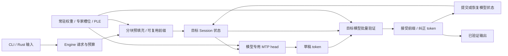

# Ingot 推理引擎：性能能力补全 Spec

> **历史记录**：这是 2026-10-13 的实施规格，其中 MTP、矩阵预填充等必做项此后已大部分实现；文中的工作区路径和“尚未实施”状态均为当时情况。当前状态见 [README.md](README.md)。

版本：v1，2026-10-13。状态：**供审阅的实施规格；不是实现完成或性能达标声明。**

主工作区：本仓库根目录。
本文补充原 `ARCHITECTURE.md`，
替代其中“首版先不做”作为后续性能工作的排期依据；Rust / Metal 的执行所有权和模型数学边界继续保留。

本轮只编写 Spec、核对现状和资料，不启动下一轮模型实验，也不改运行代码或模型。

建议先读第 4 节优化清单、第 7 节质量标准、第 10 节性能目标和第 11 节实施顺序；其余章节定义落地细节。

## 1. 目标与完成定义

### 1.1 恢复原始目标

目标是：**在现有 M2 Max / 96 GiB 上，把适用于 Qwen3.8-Flash-Next 和 GLM-5.3-Flash 的有效优化接入独立 Rust / Metal 引擎，在明确质量与内存约束下，争取同机已测方案中最好的完整请求性能。**

这不是“模型能输出文本”或“比自己的上一版快一点”就完成的项目。“使用所有优化方案”在本文中的含义是：

1. 对当前模型和硬件相关的主要方向建立完整覆盖，不能把关键能力永久写成“后续可选”。
2. 必做能力必须实现、进入真实执行路径并验收；研究候选必须有可复查的采用、否决或未解决结论。
3. 对有收益的组合完成集成和组合复测。不能把不同实验的收益相加，不能堆开关代替有效默认值。
4. 无收益、质量退化或不适用于这台硬件的方案不强行默认启用；结论只约束已经测过的条件。
5. 不以裁剪目标模型专家、降低目标 top-k、跳层、替换目标权重或缩短任务来冒充等价加速。

历史用户要求：2026-10-10 要求最快 MoE、改变逐字节一致的验收方式、
矩阵预填充、草稿词表裁剪、常驻与有限内存分别测量；2026-10-11 授权独立 Rust / Metal 架构。
本次用户要求先完成本文。

### 1.2 两条性能目标

| 目标 | 优先工作负载 | 约束与用途 |
| --- | --- | --- |
| 本机最快可用 | Qwen 路由专家常驻；1K / 4K 输入、最多 256 输出；无前缀复用与多轮复用分别测 | 以完整请求、TTFT、解码吞吐为主；预算包含草稿、状态、工作区，不能靠系统持续换页刷成绩 |
| 有限内存下高效 | Qwen 8 / 16 GiB；GLM 16 / 32 GiB；同样的 1K / 4K 请求 | 以固定预算下完整请求和读取等待为主；在 96 GiB 机器限预算不能宣传成真实 8/16GB Mac 或冷 SSD |

GLM 的当前目标文件约 110.027 GB，超过本机物理内存，不能假设完整常驻；32 GiB 为当前有效主基线。
Qwen 的“常驻”指路由专家常驻，PLE 大表仍按行读取，不声称整个文件驻留。
8K 是本期必须通过的功能、质量和性能覆盖；32K 是之后的扩展验证，不阻塞本期、也不提前宣传支持。

### 1.3 三种结果分别报告

- **能力补全**：第 4 节必做项进入生产入口，真实执行、错误/状态测试和质量验证通过。
- **有收益的优化交付**：相对冻结的原生基线，完整请求有可重复收益，组合后的退化边界已检查。
- **性能目标达成**：完成第 10 节同机对标并满足竞争性目标。前两项通过不能替代这一项。

“Mac 上最快”是项目方向；最终只能声称在列明硬件、版本、权重、质量和任务范围内领先已测对手。
如果能力补齐但仍落后，必须明确报告未达标、差距和剩余瓶颈，不能改写目标为“本轮完成”。

## 2. 当前真相与断点

### 2.1 已核对的实现

当前 Git HEAD 为 `170a031e43a962dba072f686d7b17b5e46749826`，只代表早期版本；完整引擎主要在未提交工作区。
实施起点是实际源码快照及 `validation/native-performance-3.json` 的指纹，不是只 checkout 该 HEAD。
本次核对的 22 个源码/测试/工具指纹与第三轮记录一致。

| 能力 | 当前状态 | 后续缺口 |
| --- | --- | --- |
| Qwen / GLM 原生前向、分词、greedy 生成 | 已实现 | 不能因此认为完整性能能力已完成 |
| 固定预算、逐层 LRU、已知下一专家读取与当前计算重叠 | 已实现 | 缓存分配和读取并行的上限、关键路径仍需测 |
| 按专家分组的预填充 | 已实现，最多 8 token | 缺较大块和针对真实 shape 的矩阵计算路径 |
| 四行 SIMD 投影、部分量化块解码复用 | 已实现 | 缺高效 GEMV/GEMM 选择、必要融合、验证批优化 |
| 稀疏注意力 | 已跳过遮蔽点积；GLM 每池排名一次 | 后续 values 仍扫描历史，未完成按选中索引访问的紧凑路径 |
| 激活、循环状态、KV | F32，Metal Safe math | 未完成更快计算顺序、混合精度的模型级质量评估 |
| MTP、批量目标验证、状态恢复 | 原生引擎未实现 | Qwen、GLM 都需要模型专用实现 |
| 草稿输出头量化 / 词表裁剪 / 历史提议 | 旧路线已有代码、产物和实验 | 未接入原生引擎；不同输入/预算下收益并不一致 |
| 前缀状态复用 | 未实现 | 只有 Engine 权重与 pipeline 复用，不等于多轮前缀缓存 |
| 跨框架正式测速 | 原生主线未完成 | 不能从数值 oracle 的运行时间推导框架性能排名 |

第三轮短请求实测：Qwen 8 / 40 GiB 为 6.27 / 7.95 token/s，GLM 32 GiB 为 2.63 token/s。
输入容量 256、输出分别 29 / 140 token；只作为历史基线线索，不能替代本 Spec 的 1K/4K 成绩。

### 2.2 旧路线必须复用的知识

旧项目：`strata-mac`，重点材料是 `README.md` 和 `macos/` 下质量与对照工具。
复用其受许可保护的算法、算子思路、测试和失败经验，**不把 libllama/libggml 接回生产路径**。

| 旧证据 | 本次决定 |
| --- | --- |
| 已实现 MTP、Q4 草稿头、词表子集、neural-first 历史尾部提议 | 作为原生实现和消融的来源；旧速度不计入新引擎 |
| 预填充块扩到 1024，并按专家处理、读算重叠 | 必须评估较大块；1024 是候选值，不照抄为默认 |
| Turn196 矩阵预填充数值指标通过，但代码任务 16/20→14/20 | 保留实际退化案例；不能描述成只因不逐位一致被否决 |
| Turn205 局部矩阵计算更快，数学 top-1 在 35 个位置中 33 个一致；未继续测任务 | 属小样本数值筛选失败，实际任务退化未知；不能等同整模型质量结论 |
| 词表子集提高某些短请求速度，却损害罕见词接受率或长请求时间 | 不默认全场景采用；要求中文、代码、罕见词分别报告 |
| MTP 请求位置零的 hidden carry 曾跨请求污染 | 将“新会话起始状态清零、重复请求、交替输入”作为必测回归 |
| 多轮自适应草稿长度、融合和调度候选没有稳定整请求收益 | 避免原样重复；新尝试必须说明执行结构或成本模型有什么变化 |

之前“旧矩阵优化只被位级一致挡住”的总结不完整；本文按以上原始记录修正。

### 2.3 权重前置条件

- Qwen 主模型仍是现有两分片 GSQ-RCO IQ2_XS，架构 `qwen4exp`。文件名不等于内部统一量化格式。
- 本机已有 `~/Models/Strata/MTP/mtp-Qwen3.8-Flash-Next-Q8_0.gguf`，4,137,429,280 bytes。
  本次头部检查发现 34 个张量、`nextn_predict_layers=1`、`blk.48`，包含 eh projection、norm 和 HC head。
  另有本地 Q4 草稿产物及 75,264 行 shortlist；它们是候选，不是全部通过当前引擎验收的模型。
- 当前 GLM 两分片头部没有 `nextn` / `mtp` 张量，只有 `blk.0`～`blk.44`。官方配置声明一个 NextN 层，
  **配置有 MTP 不代表当前 GGUF 已携带草稿头**。必须获取可验证、匹配同一目标检查点的草稿张量及公式。
- 实施前对将使用的模型/草稿/映射完整记录哈希、来源、版本、许可证、形状和 tokenizer 身份。
  现有主模型不覆盖、不重新量化；新增草稿/转换产物另存。优先只取得缺少的头部，避免无必要下载整个大模型。
- GLM 草稿暂时不可得时，其他优化继续；GLM MTP 状态保持“未解决”，不能改成“已补全”或用假草稿测试代替。

## 3. 架构边界与最小设计

保持一个 Rust crate、直接 Metal、一个模型和一个活跃 Session。复用现有 GGUF、Tokenizer、Weight、ExpertCache、
模型前向和统计工具。Qwen 与 GLM 的注意力、循环状态、MTP head 分别实现，只共享确实相同的计算/计时职责。

最小实现增加：模型专用草稿路径、所有验证位置的输出、必要状态保存/恢复、MTP 生成循环、热点内核与有限工作区。
不为此建设通用计算图、插件/后端注册系统、规则引擎、自动调参平台或多级性能预设。



此图是拟实现路径。当前生产 `Engine::generate` 仍为普通 greedy 循环。

### 3.1 公共接口约定

沿用 `Engine`、`Session`、`Cancellation`、`Generation`；不要求兼容旧调用签名或增加兼容包装。
仅增加一组真正影响用户选择的推测解码参数，以下为接口草案而非已存在 API：

```rust
pub struct DraftConfig {
    pub model: PathBuf,
    pub max_tokens: usize,
    pub vocabulary: Option<PathBuf>,
}

Engine::load(model, budget_bytes, context_capacity, draft: Option<DraftConfig>)
```

- CLI 对应 `--draft-model`、`--draft-tokens`、`--draft-vocab`；已有模型、预算、上下文和输出长度参数继续表达原职责。
- `None` 明确执行普通生成；指定草稿但不匹配、缺张量、预算不足或后端不支持时返回错误，不静默忽略参数。
- 初期验证草稿长度 1、2、3，再按证据扩大；这些是实验点，不给产品增加一排算法开关。
- 内核、分组、矩阵分派由 shape、真实格式和经过验证的实现决定；不增加“极速/安全/智能”等预设。
- 对已指定草稿的生成，可在边界处减少提议数以满足剩余输出/上下文容量；必须记录实际提议数。
- `Generation.statistics` 增加实际执行路径与推测统计。没有计数/trace 证据，不能声称 MTP 或某种 kernel 已命中。
- 本期生成语义仍为 greedy。随机采样不以不正确的接受算法凑“支持”；以后单独设计严格分布等价的采样验收。

### 3.2 模型内部接口约定

在现有模型方法中分清三种调用目的，不新增后端 trait 或公共插件接口：

| 调用 | 所需返回 | 状态语义 |
| --- | --- | --- |
| 普通预填充 / 单 token | 末位置目标结果，必要的草稿 hidden | 只推进输入范围；不为整个长 prompt 分配全词表 logits 矩阵 |
| 推测验证块 | 每个验证位置的目标选择；调试时可导出全词表 logits；对应 draft hidden | 暂时推进，直到 Engine 确认接受前缀才提交可见历史 |
| 保存 / 恢复 | 模型私有 checkpoint，包括必要缓冲区与逻辑位置 | 仅服务当前 Session，不能拿其他 Engine/会话的快照恢复 |

正常 greedy 选择可留在 GPU，只回传 token 和需要的状态信息；完整 logits 仅为验证或确有需要的调用导出。
MTP prompt catch-up 分块消费目标 hidden 并计入预填充时间，不永久保存整段 prompt 的全部词表输出。
接口重构同时迁移现有 CLI、examples 和测试，不留下两套需要同步维护的生成循环。

## 4. 优化覆盖清单

“必做”要求可用实现和真实验收，不代表每个候选都强制默认开启。“评估”至少需要成本上限分析和针对性的实测，
或清楚证明硬件/模型不适用；不能只写“以后再看”。

| 编号 | 能力 | 要求 | 真实执行完成条件 |
| --- | --- | --- | --- |
| O1 | 同机基线与正常提交 profiling | 必做 | 原生 / 固定 llama.cpp / 旧 strata-mac / 可运行 MLX 系方案的版本、权重和条件明确 |
| O2 | Qwen 原生 MTP head 与批量验证 | 必做 | 使用真实 Q8 head，输出由完整目标验证，报告成本、接受数和收益 |
| O3 | GLM 原生 MTP head 与批量验证 | 必做 | 匹配草稿产物落地，按 GLM 公式实现，不把 Qwen head 或状态强套过去 |
| O4 | 推测状态保存、恢复、重放、跨请求清理 | 必做 | 0 接受、部分/全部接受、EOS、取消、错误均不污染后续状态 |
| O5 | 草稿输出词表子集和草稿头量化 | 必做 | 两种能力独立可测；主模型仍完整词表，局部 ID 正确映射回全局 ID |
| O6 | 较大分块、专家分组、预填充矩阵计算 | 必做 | 超过 8 token 的真实批次命中矩阵路径，模型质量及内存通过 |
| O7 | 量化 GEMV/GEMM、验证批小矩阵与必要融合 | 必做 | 热点真实格式/shape 覆盖；含 gather/scatter 的完整路径和请求获益 |
| O8 | 紧凑稀疏注意力、在线归一化/值聚合 | 必做 | 选中集合和因果性不变；不再靠全历史扫描完成主要 values 工作 |
| O9 | 工作区复用、GPU 内路由/greedy、减少不必要同步 | 必做 | 生命周期和在途所有权正确；完成一次整体评估，不反复只磨局部微秒 |
| O10 | 有界并行读取、缓存利用、读算重叠 | 必做 | 冷逻辑槽位/暖文件缓存下读取等待下降或明确量出无收益边界 |
| O11 | 混合精度及不同归约/融合顺序 | 必须评估 | 算子和整模型质量验收；不能以非位级一致直接否决，也不能暗中降精度 |
| O12 | 前缀状态复用、neural-first 历史提议 | 必做 | 一个有界前缀的真实多轮收益；历史提议只用当前可见历史且由目标验证 |
| O13 | 跨层缓存分配、专家预测预取、草稿长度选择 | 必须评估 | 先测上限/误预取/驱逐成本；有净收益再进入默认路径 |

O5/O12/O13 不应抢在高效目标验证之前成为调参主线。候选只在一个场景获益，可以明确作用范围，
不要求所有场景都加速；也不为每个小收益新建一组公共模式。

## 5. MTP 及状态正确性设计

### 5.1 必须对齐的模型输入

草稿头不是仅输入 token 的通用小模型。逐模型核对 target hidden 的截取位置、HC 混合前后布局、归一化、
embedding 与位置关系、草稿层自身状态、输出头是否共享，以及 Qwen 的 PLE、GLM 的索引共享。
用固定参考实现逐层导出真实中间值，不能只凭最终文本合理就认定草稿正确。

Qwen 先用已有完整 Q8 head 建立正确性；Q4 和 shortlist 之后分别消融。GLM 先解决头部产物和模型公式，
不得从 `num_nextn_predict_layers=1` 推断其张量布局等同 Qwen。

### 5.2 一轮 greedy 推测的语义

在已消费历史 H 上，已有目标 logits 对应下一 token。草稿提出 `d1…dk`；目标按相同因果上下文验证。
内部 forward 接口必须能返回每个验证位置的 logits/目标选择，以及草稿需要的 hidden，不能只返回块末位置。

1. 保存必要的目标和草稿状态、消费位置与待反馈 token。
2. 产生真实草稿提议。不能用离线未来答案或本轮尚未验证的目标输出充当预测输入。
3. `d1` 与 H 的目标选择比较；后续 `di` 与目标在 `H+d1…d(i-1)` 的选择比较，明确处理位置偏移。
4. 只接受连续正确前缀。在首个拒绝位置输出目标的纠正 token；全部接受时可输出目标额外 token。
5. 恢复到恰当位置并推进接受前缀；实际 Session 只能包含已提交历史，纠正/额外 token 的 pending 语义与普通生成一致。
6. EOS、输出上限、上下文上限和取消均可提前结束。未经验证的草稿不得进入输出回调。

输出长度不足一轮时缩短实际提议，不能越界后截字符串；全拒绝、全接受和零提议都是正常可测路径。
greedy 的并列分数规则沿用最小 token ID。采样分布、温度或主模型词表不因推测而改变。

### 5.3 状态恢复边界

| 状态 | Qwen | GLM | 必须保证 |
| --- | --- | --- | --- |
| 循环矩阵 | GDN | KDA | 恢复所有被改写元素，不能只退 token 计数 |
| 卷积历史 | mixer / PLE 所需历史 | Q/K/V 卷积历史 | 次序、尾部及新请求初始化正确 |
| 注意力缓存 | QSA K/V、索引及压缩尾部 | MLA latent、DSA key/gate/pooled、共享索引语义 | 逻辑长度与被修改尾部一致，拒绝分支不可见 |
| 其他 | PLE 历史、位置、HC hidden | 位置、mHC hidden、draft 索引状态 | target/draft 的 hidden 对齐，不跨请求 carry |
| Engine 状态 | consumed / pending / output | 同左 | 已输出 token 不重复、不跳过，消费历史可重建 |

首个正确实现允许保存必要可变状态、拒绝后恢复并重放接受前缀。长 KV 前缀若严格只读，不复制整块，
但必须证明所有写入范围；可变循环矩阵和池化尾部不能遗漏。
仅在此实现正确后优化为逐位置快照、尾部保存或 delta；不引入通用事务、分支树或持久化快照系统。
复制量、复制耗时、重放 token 数和耗时必须进入 MTP 成本统计。

已提交 GPU/读取任务完成之前不得复用或覆盖快照/专家槽位。设备错误仍要求失效或重新装载，不能用回滚掩盖设备故障。
请求取消和输出回调失败沿用现有错误契约；正常与推测路径均须能在丢弃会话后重新请求。

### 5.4 草稿成本与默认选择

- shortlist 根据同一 tokenizer 的独立中文/英文/代码训练材料生成，保留来源、哈希、覆盖率及全局 ID 映射。
  不使用测评题、基线答案或测试输出统计词频；现有 75,264 行列表先作为可复现实验输入。
- 仅裁剪草稿输出计算，不裁剪目标输出头、目标专家或目标语义。目标的纠正与验证仍覆盖完整词表。
- 报告中文、代码、数学、罕见 Unicode/符号的提议数、接受数、接受长度和完整请求时间。接受率升高不自动等于更快。
- 草稿 Q4 等低精度仅影响草稿提议；必须在目标完整验证下重新测接受效率和最终行为，不覆盖原 Q8 文件。
- neural-first 历史提议可以用已消费 prompt 和已确认输出；命中后仍完整验证，不读取未来 token。
- 草稿长度先用少量固定长度消融，只有明显跨负载收益才加入简单有界选择。不得据训练提示词硬编码路由规则。
- 只有端到端收益成立的已验收配置才成为该条件的推荐/默认。GLM 若因头部/快照成本无收益，保留真实能力与否决证据，
  不能写成“GLM 未做 MTP”，也不能默认开启拖慢用户。

## 6. 计算、预填充与内存优化

### 6.1 从真实矩阵选择内核

分别采集普通 decode、MTP 验证小批次、较大 prefill 的真实矩阵形状、路由重叠、步长和量化格式。
先覆盖当前热点 Q2_0 / IQ2_S / Q2_K 及输出头/HC 所用 IQ4/BF16 格式，其余按正常提交时间线排序。

- GEMV：量化块一次解析、向量化加载、SIMD 分工、合理的行 tile，检查寄存器压力和尾行。
- 小批矩阵：优化 2～若干验证 token 的权重复用，不能只调大 prefill 而让 MTP 验证落到慢路径。
- 较大 GEMM：有界地解量化到 tile，使用设备实际支持的矩阵运算；不在模型运行时展开全部专家为 F32 常驻。
- 专家计算把相同专家的 token 聚合，按预算分组读取，结果归回正确 token/rank；融合 gate/up、激活、down 或 scatter
  前先确认避免的读写量和数值变化。原型、局部最优和生产调用必须是同一算法。
- 归一化、HC/mHC、QKV、卷积、残差等融合按实测贡献选择；不把所有算子先重写一遍。

M2 Max 使用其真实支持的 Metal 能力。CUDA/Tensor Core、ANE 或其他芯片专属能力不是可直接打开的优化。
FP8/INT8/更快数学选项仅在存在可验证实际计算路径时评估，不能通过 dtype 标签推断硬件加速。

### 6.2 预填充不再固定 8 token

移除把所有输入都切成 8 token 的唯一执行策略。在 workspace 预算内分块；用 8/32/128/256/512/1024 等实验点
定位吞吐、读取复用和峰值的关系，再确定实现支持的有效范围，不把整张扫描表变成产品配置。
GDN/KDA 递推、卷积和因果索引更新必须遵守 token 顺序；可以批量计算的投影/FFN 不因此退回逐 token。

同时记录：实际 block 大小、每专家 token 数、唯一专家数、逻辑读取、槽位命中、计算批次数、prefill 吞吐和 TTFT。
正确性测试必须让大矩阵候选真正命中；只用 4/8 token 的 teacher forcing 验证而绕过候选路径不算验收。

### 6.3 稀疏注意力

在保持模型选块/选池、尾池、因果和 tie 规则的前提下，生成紧凑索引，后续 score/value 直接访问选择集合。
评估融合 score、稳定 softmax 与 value 的分块在线算法，减少中间数组和全历史扫描。
覆盖未满首池、2047/2048/2052/2055/2112 附近、块边界和完整 8K；不得靠改变 top-k、窗口或丢弃尾部换速度。

### 6.4 工作区、提交与 GPU 常驻

按一次 forward 的生命周期复用有限工作区；权重/长会话状态/短时中间张量分开计算字节。
无需引入通用 allocator 平台，先替换真实高频 `Gpu::output` 分配。
常驻路由、token 选择和可合并算子尽量留在 GPU；调试完整 logits 的导出不进入正常热路径。

取消、流式专家 ID 回读和槽位覆盖是真实同步边界。除此之外评估多个算子共享 encoder、跨层有界提交、
编码复用或间接执行，但每个候选都要量出 CPU 编码、GPU 区间、空隙和完整请求变化。
已测分配约占 9%、四层合并收益小的结论属于第三轮路径，不足以解释全部性能差距，也不支持无休止微调。

### 6.5 读取、缓存与预算

统一预算包含目标常驻权重、草稿权重、专家缓存、target/draft 状态、验证快照、prefix checkpoint、workspace、
在途 I/O 缓冲与主机开销。MTP 不能额外偷用预算外的几 GiB；预算不足在加载/规划边界明确返回。

以现有位置读取和槽位 pinning 为基础，评估有界读取并行、相邻范围合并、下一组已知专家预取与 GPU 重叠。
先用“已知专家提前备好”的诊断量出等待上限，再决定是否实现预测预取或跨层槽位重分配。
预测仅可改变读取时机；错误预测不能改变实际路由，且需报告浪费字节、驱逐、带宽争用和净延迟。

不要默认增加缓存容量：已发生的 64 GiB GLM 探针内存压缩证明需要同时观测系统状态。
RSS、physical footprint、Metal 分配、wired、compression、swap、逻辑 `pread` 与物理读取分别报告，不直接相加。
未证明冷读时统一标注“暖/未知文件缓存”。不通过清理全机缓存或停止他人任务制造实验条件。

### 6.6 前缀复用

第一版只保存一个显式有界、已确认的前缀检查点，复用现有状态快照；不做磁盘缓存、跨进程存储或多用户淘汰平台。
匹配实际 token 前缀，并绑定目标/草稿身份、计算精度、分块/位置语义和状态版本。
只能复用可证明等价的计算边界；不匹配时按正常输入重新计算，不复用近似文本相似度。
分别测复用关闭、真实命中和未命中。跨框架基础速度比较默认关闭 prefix reuse，避免重复 prompt 伪装 prefill 加速。

## 7. 数值与任务质量标准

### 7.1 三类验证，不共用一个位级一致门槛

| 改动 | 主要要求 |
| --- | --- |
| 索引、缓存、状态所有权、I/O、纯调度 | 数学和计算路径未变时保留精确结果检查；离散索引、边界、停止语义必须正确 |
| 矩阵内核、融合、归约顺序、混合精度 | 用独立数值参考、分布与任务质量验收；浮点不是逐位相同不构成自动否决 |
| MTP、shortlist、历史提议 | 相对同一已验收目标计算语义保持 greedy 选择/停止一致；不得以“质量差不多”掩盖错误接受 |

MTP 的目标批量验证须单独验证数值一致性。如果批量与逐 token 的数值路径不同，先把该计算路径作为 O7/O11 候选验收，
再检验推测循环是否忠实于这个目标；不能把批量算术差异与状态回滚 bug 混为一谈。
必须同时报告与普通逐 token 目标的分歧及其第一发生位置；有未解释分歧时不宣称精确等价 MTP。

### 7.2 参考层次

1. 算子：真实量化字节独立解码，以 F64 累加或其他明确高精度实现计算相同量化权重的结果。
2. 模型：固定 llama.cpp 和第二独立实现，同 tokenizer、模板、输入、状态精度；原生 F32 基线用于定位回归。
3. 更高位同检查点：产物可得且本机可承受时，离线取得整模参考。缺少它时明确写“同量化实现验证”，
   不声称恢复了量化损失，也不为等待整个 BF16 模型阻塞所有同量化优化。
4. 实际任务：独立的中文、代码、数学与长上下文测试，评分依据正确答案或可执行检查，不让基线输出充当正确答案。

### 7.3 数据集与预先冻结

- 开发 smoke：复用旧 60 题，但修清评分契约；数学答案正确与 JSON/格式遵循分别统计，只有题目要求的格式才算错。
- 正式任务：中文至少 200、数学至少 300、代码至少 200 个独立样本；保留调优未见的测试集、参考答案和评分脚本。
  代码使用受控进程、超时、资源限制和隔离的临时目录执行，不把生成代码放入开发账户直接运行。
  中文以可判定的提取、约束遵循和封闭问答为主；数学按冻结的答案归一化评分；代码按独立用例评分。
  自由创作的人工盲评单列，不用未经校准的模型裁判替代上述正确率。
- Teacher forcing：中文/英文/代码/数学/罕见 token，各类至少 4 个独立文档、累计至少 4K 计分 token；
  全文 NLL，固定抽样位置记录完整词表 logits。位置按文档冻结，不能只挑 top-1 容易一致的位置。
- 长上下文：至少 24 个独立样本覆盖 2K/4K/8K，包含引用/检索、代码跨段依赖、位置敏感信息与非重复自然文本；
  另保留已有重复序列状态测试，两者不互相替代。
- 草稿词表训练集、速度调优输入、质量调优集和最终验收集分开，记录来源、许可证、ID/hash、排除关系。

数据集、精度、阈值、主要指标、性能任务权重、最大重复数在候选运行前冻结到本轮 evidence。
允许基于独立参考校准修订下一版本协议；不得看完同一候选结果后放宽阈值让它通过。
质量任务的输出上限按题型独立固定，不照搬速度集的 256-token 上限；思考模型要有合理作答空间。
先检查基线完成率和评分脚本，截断、未给最终答案、格式错误分别列出，避免两边都无法完成任务却被判为“无退化”。

### 7.4 v1 质量验收线

以下为本项目提出的工程验收标准，不是行业通用定理；阶段 P0 在未运行新候选前检查评测可执行性并冻结。

- 所有输出/状态有限；越界、错误 slot、非法索引、跨请求污染、错误 EOS 或未经验证输出为实现失败。
- 同一量化目标的数值候选：整体 PPL 相对上升不超过 **1%**，各语料类不超过 **2%**。
- 报告 KL(reference‖candidate) 的均值/p95/max、top-1、top-32 集合重叠、top-1 margin 和首个分歧。
  **不再用“35 个位置 top-1 低于 95%”单独停止实际任务评测**。这些值用于归因和异常调查，任务/NLL 是主要质量证据。
- 正式任务按样本配对：总体和中文/代码/数学各类的正确率下降均不超过 **2 个百分点**，并给出预先指定方法的
  单侧 95% 非劣置信下界；要求下界不低于 −2 个百分点。小样本或不确定区间过宽记为证据不足，不冒充通过或确定退化。
  数据预先准备扩展部分，每类最多扩到 1,000 个，使用预先规定的两阶段检验/误差分配，不能反复看结果直到显著。
- 长上下文须无状态错误/位置系统性失败；报告逐类任务结果及配对区间。24 个样本是覆盖测试，不能据此宣称普遍质量等价。
- MTP 在不更换目标数值路径的试验中要求最终 token/EOS 与普通 greedy 对照一致；提议本身可以不同。
  同一执行路径的状态恢复、分段调用和重复会话不允许靠任务统计掩盖错误。

算子相对误差阈值在 P0 从独立解码与累加参考冻结到真实 tensor fixture，按算子类型、量级、累积长度和精度说明理由；
不使用一个任意的统一 `atol` 管所有算子。局部误差小也不能豁免整模质量测试。

## 8. 测试矩阵

| 层级 | 必测内容 | 最小通过证据 |
| --- | --- | --- |
| 装载与格式 | 真实 13 种目标格式；Qwen 草稿格式；GLM 新草稿格式、shape/词表/模型身份 | 真实 tensor 对照、错误产物明确失败、许可证与来源记录 |
| 内核 | 行/列/tile 尾部、跨专家偏移、混合路由、零/满 mask、同分 tie、真实数值范围 | 独立 CPU 参考及候选路径计数；GEMV/GEMM/融合分别检查 |
| 大块预填充 | 不同切块、边界前后、非满块；常驻和逐层缓存 | 被测试的真实大矩阵分派命中；全词表/NLL及后续生成检查 |
| MTP head | target hidden 截点、位置零、embedding、head 层及 logits | 独立 reference 中间张量和真实提议 |
| MTP 接受 | 0/1/部分/全部接受；长度 1/2/3；target 纠正和额外 token | 输出序列、消费历史、pending、计数与普通目标一致 |
| MTP 恢复 | 跨 GDN/KDA、卷积、QSA/DSA/PLE、池化尾部 | 恢复后未来多 token logits/生成一致，不只比较当前位置 |
| 生命周期 | prefill/draft/verify/replay/输出回调期间取消；错误后新会话；交替输入 | 无未验证输出、无悬空 buffer、槽位安全、可再次请求 |
| 内存 | 正好可运行预算、必需工作集不足、草稿挤占缓存、较少槽位、8K状态 | 完整 footprint/分配/压缩记录；不足返回清楚错误 |
| 前缀 | 全命中、部分边界、不匹配、新会话、不同草稿/精度、取消 | 与不复用的同路径一致；命中与节省时间可观测 |
| 质量 | 正式中文/代码/数学、罕见 token、自然长上下文 | 第 7 节完整结果，不以 smoke 代替 |
| 最终运行 | CLI 和 Rust 公共接口、动态依赖、源码/二进制对应关系 | 被验收二进制置于实际入口，运行路径计数对应源版本 |

保留 `cargo fmt --check`、Clippy `-D warnings`、release build、普通测试与实际权重专项。
GPU/大模型任务在 apple 串行执行。普通 CI/测试不隐式加载百 GB 模型；硬件测试显式指定。
不为纯文档或可逆小改动编写镜像式测试。

## 9. 性能协议

### 9.1 比较对象和条件

| 对照 | 用途 | 必须对齐 / 分开的内容 |
| --- | --- | --- |
| 第三轮原生源码快照 | 内部进步 | 同权重、输入、预算、生成语义，重新跑同一新协议 |
| 固定兼容版本 llama.cpp | 基础计算效率 | 同 GGUF、全 GPU 可用路径、相同目标 KV/状态精度、MTP 关闭 |
| 旧 strata-mac 的正常及最佳已验收 MTP 配置 | 防止重写丢失性能 | 固定完整补丁/依赖；分别报告常驻/缓存、AR/MTP |
| 当前兼容的 llama.cpp / oMLX 或 MLX serving | 最快可用系统参照 | 同检查点尽量对齐；不同量化/精度单列，并有质量对照，不称纯引擎倍数 |

在 P0 冻结真正能运行的版本与构建选项。最新 upstream 若不支持当前自定义格式，使用兼容分支，
不能拿报错、CPU fallback 或错误分片配置作为“对手慢”的成绩。
先测 AR 对 AR，再测各自已验收的最佳配置。不能只把我们无 MTP 与对方 MTP 相除后当成内核差距。

### 9.2 工作负载

正式首轮至少覆盖以下组合；微基准、质量套件和完整请求速度分开执行。

| 组合 | 输入与输出 | 主要用途 |
| --- | --- | --- |
| Qwen 专家常驻，prefix off | 1K/4K 各中文、代码、数学；最多 256 输出 | 首要竞争性结果，普通和 MTP 分列 |
| Qwen 8 / 16 GiB，prefix off | 同上 | 预算内专家流式性能 |
| GLM 16 / 32 GiB，prefix off | 同上，保持同一思考模板 | 当前实际可用速度；计入思考 token |
| 两模型 8K | 至少自然中文与代码，各最多 256 输出 | 长输入 TTFT、解码与峰值 |
| 两模型多轮复用 | 固定 4 轮，逐轮添加不同内容 | prefix 命中/未命中收益，不能混入无缓存基线 |

原始字节文本、模板渲染结果和 token ID 都保存。实际输入长度包含模板；使用自然完整片段达到目标长度，
不以重复一个 token 代替正式速度负载。原生与参考使用同一 token 序列的计算对照，另做真实文本入口检查。
输出上限 256 不代表一定输出 256：正常遵守 EOS，保留实际长度和停止原因。
候选异常变短不能成为加速收益；固定长度计算探针可独立使用 teacher forcing，但不能称真实生成成绩。

### 9.3 计时与统计

- 每个版本持久 Engine，加载/Metal 编译/首次请求单列；正式请求前一条规定的预热，原始预热仍保存。
- 正式 A/B 使用 AB/BA 交替，至少 **6 对**；有收益接近波动的情况按预先计划最多 12 对。
  不每秒轮询，不因为慢样本或早停不漂亮就重跑；硬件错误等无效条件提前定义、记录原因。
- 只有一个大模型引擎占用 GPU。以一次版本进程的“预热 + 持久 Engine 测量序列”为实验块，版本块交替；
  稳态复用与进程重启的首次请求分别统计，不要求两个模型同时驻留来实现 A/B。
- 主要指标是请求进入到最后一个已验证 token/正常结束的时间，不含模型加载；同时报告包含启动的首次完整体验。
- TTFT 同时报第一个已验证 token 和首个非空用户可见字节；decode 吞吐使用实际已输出 token 与对应墙钟区间。
  MTP 的一个 round 时间不能均分伪装成逐 token 实测延迟；单列 round、接受批次及输出间隔。
- 基础 decode 指标统一为首 token 后输出数 / 首 token 到结束的生成时间，并明确 EOS 处理；
  旧报告使用 decode step/EOS 的口径保留为历史，不与新口径直接混算。
- 提供加权吞吐、中位数、范围、样本方差、逐请求配对比、配对置信区间；不同输入先逐项展示，再按冻结权重汇总。
  v1 中 1K/4K 等权、中文/代码/数学等权，各内存预算单列；按配对实验块重采样计算区间，不能把同一进程内相关请求
  当成大量独立样本。公开重采样次数和种子；6 对所得区间属于本机有限样本估计，不宣传生产 p95。
- CPU 等待包含 GPU 时间；阶段重叠不能直接相加。正常命令时间线用于归因，逐 kernel 强制同步诊断不进入正式成绩。
- 记录版本、输入、预算、后台 GPU/磁盘活动、温度/功耗可得项、系统压缩和 swap。
  检测到共享资源竞争时先按预定规则处理，不能事后只删不利一侧；同一 GPU 不同时跑两个引擎。

### 9.4 推测与数据流指标

MTP 必须记录 proposed / accepted / committed、每轮实际 k、接受前缀长度、目标验证次数、草稿/目标 token 数、
head/verify/snapshot/replay 时间与字节、target/draft 文件读取和缓存占用。
另记录真实 prefill 分块、专家分组大小、完整/裁剪词表计算行数、主要 kernel 分派计数。
性能计数应轻量、可关闭；正式速度同时验证关闭诊断开销的结果。

## 10. 采用标准与竞争性目标

### 10.1 单项采用

1. 指定它解决的是 prefill、decode、MTP、长上下文还是有限内存；冻结主要负载及不回归范围。
2. 质量/状态通过后，以完整请求配对结果决定采用；微基准快不能越过这一步。
3. 主要负载的耗时比 B/A 的 95% 区间应支持小于 1。局部场景收益可以保留，但须注明其他场景影响。
4. 若新增代码/复杂度明显而整请求改善不到 3%，通常不作为下一轮重点；这不是强制否决一切小收益的机器规则。
5. 超过 5% 的可重复关键负载退化必须解释和解决，或把用途明确限定在已受益场景；不能被平均数掩盖。
6. 正确性修复可以单独采用，不伪装成性能收益；证据不足与失败分开记录。

### 10.2 本期明确争取的性能结果

以下是验收目标，尚未证明可达，不能写成承诺速度：

- **同权重基础路径**：Qwen 专家常驻 1K/4K 完整请求，达到冻结的同机兼容 llama.cpp AR 基线；
  按冻结任务权重汇总的几何耗时比不大于 1、95% 区间上界不高于 1.05，关键子组不出现超过 5% 的已确认退化。
- **组合优化路径**：Qwen 最佳已验收配置，相对同权重参考最佳已验收配置，争取汇总完整请求至少快 **10%**，
  且配对区间支持真实收益；同时与可比质量的 oMLX/MLX 最佳配置单列比较。
- **有限内存路径**：Qwen 8/16 GiB、GLM 16/32 GiB 分别争取优于同预算兼容参考；至少证明存在可重复的整请求优势，
  不能用 Qwen 的进步代替 GLM，也不能把预算外分配或系统压缩算成合格配置。
- **长上下文**：完成 8K 自然语料质量与完整请求测量；稀疏/前缀优化的收益在其对应工作负载证明。

公开 M2 Max 上约 30～40 token/s 的 Qwen MTP 数据是能力参照，量化、内存、输入不同，不直接规定为同条件硬门槛。
在 P0 得到同机对照后记录具体目标秒数/token/s；不能因当前原生较慢而把目标下调为“再提升 10%”。

若上述目标未达成，交付“能力完成、性能未达标”的事实及成本分解，继续围绕主瓶颈工作。
连续 5 个候选无采用收益必须做一次方向复盘，停止重复参数微调；复盘不自动结束项目或豁免未做能力。

## 11. 实施顺序与阶段出口

| 阶段 | 交付与行动 | 出口条件 |
| --- | --- | --- |
| P0：目标、基线与质量协议 | 固定实际源码/模型；复用旧数据；补同机 1K/4K AR 和旧 MTP 基线；冻结评价与形状清单；查清 GLM head 来源 | 可重跑的比较、评分规则和热点，明确数据缺口；不是只写研究报告 |
| P1：目标验证和状态基础 | `forward_block` 返回所需位置结果/hidden；模型专用 checkpoint/restore；大块与小验证批接口；修清内存计费 | 真实 target 状态恢复、边界与取消测试通过 |
| P2：Qwen 完整 MTP | Q8 head、真实提议/验证/提交、统计；新请求清零；Q4、shortlist、历史提议依次消融 | CLI/Rust 的真实生成通过，完整请求对照已跑；好坏都有实际结果 |
| P3：主计算路径 | 真实热点 GEMV、验证小矩阵、较大预填充 GEMM、必要融合/混合精度、工作区/提交 | 第 7 节质量与完整请求收益；不能只交单算子结果 |
| P4：GLM 完整 MTP 与数据流 | 匹配 head、KDA/DSA 回滚、验证；结合 32 GiB 预算评估读取、草稿缓存及 O5 | 与 Qwen 同等级真实验证，不以实现了共用 enum 代替 GLM 能力 |
| P5：稀疏、缓存与复用 | 紧凑注意力、单前缀复用；有界读取、预取/跨层缓存/草稿长度上限实验 | 8K/多轮/有限内存对应负载证据，错误预取不改变模型结果 |
| P6：组合与对标交付 | 所有采用项组合消融、独立留出任务、完整矩阵、产品二进制/调用示例、更新说明 | 第 12 节逐项核对，分开报告能力与性能是否达标 |

Qwen 是首条跑通链，GLM 不被无限后置：P0 同时解决 GLM 草稿来源，P1 定义两种模型的状态边界，P4 完成独立实现。
P1～P3 可以按性能证据交叉推进；如果 MTP 首版因复制/验证过慢，先改主验证计算，不以该首版否决整个方向。
不为凑顺序重复已通过的基线；新的算术、状态或组合变化才扩大相关测试。

实验按成本分层：单次迭代先做受影响 fixture、状态用例和少量正常请求；值得保留的阶段候选才做正式质量与配对测速；
最终组合再跑完整留出集和矩阵。不要每改一个 shader 常量就重跑全部大模型测试。未通过正式质量的候选只能保留在实验产物中，
不能提前成为默认实现。旧测试可用于回归，最终留出数据不得反复用于调参。

## 12. 交付清单与完成审计

- [ ] O1～O12 的必做能力均有源码、实际入口、路径计数、测试和作用条件；O11/O13 有实际评估结论。
- [ ] Qwen 和 GLM 都有真实 MTP 结果；缺权重、尚未实现或只有模拟测试明确记为未完成。
- [ ] 较大预填充和小批验证确实命中对应内核；不是 API 接受 batch 而内部仍全部逐 token。
- [ ] 状态恢复覆盖循环/卷积/注意力/索引/PLE/位置，包含历史跨请求污染回归。
- [ ] shortlist/草稿量化/历史提议不改变目标权重、词表和接受语义。
- [ ] 所有采用的浮点优化按新协议通过，而不是靠位级一致限制搜索，也不是靠放宽阈值掩盖退化。
- [ ] 1K/4K、8K、多轮和预算矩阵已完成；原始慢样本、失败、未采用试验保留。
- [ ] 同机成熟框架比较完成；不同权重/精度的系统对比明确隔离解释。
- [ ] 源码、构建目录、编译参数、二进制和实际入口对应；`otool -L` 验证生产引擎没有意外链接参考运行时。
- [ ] README / ROADMAP / ARCHITECTURE / NATIVE_VALIDATION 与实际能力一致；每条宣称都有记录。
- [ ] 能力补全、内部提速、竞争性性能分别给出通过/未完成结论，不用一个“完成”覆盖三者。

## 13. 文件影响与证据组织

| 文件 | 拟承担的修改 |
| --- | --- |
| `src/engine.rs` | MTP 生成控制、Session 提交语义、统计、一个有界前缀复用入口 |
| `src/qwen.rs` / `src/glm.rs` | 模型专用 hidden/head、验证位置、快照/恢复、大块调度与稀疏索引 |
| `src/metal.rs` | 矩阵分派、融合/复制、工作区、命令提交、GPU 选择与轻量路径计数 |
| `kernels/moe.metal` / `qwen.metal` / `glm.metal` | 真实热点量化运算、验证小批次、稀疏注意力及模型 head 所需算子 |
| `src/weights.rs` / `src/gguf.rs` | 只补实际草稿格式/映射和必要缓存/I/O；装载边界验证与完整预算 |
| `src/main.rs` | 少量草稿参数及真实路径/统计输出，不放大配置面 |
| `tests/qwen.rs` / `tests/glm.rs` / `tests/projections.rs` | 真实状态、MTP、边界、格式和质量相关回归 |
| `examples/bench.rs` / `validate.rs` | 同口径普通/MTP/多位置/前缀开关的实验入口 |
| `tools/bench_native.py` / `check_native_regression.py` | 复用并扩展配对测试、原始结果、完整矩阵和数值分析 |
| `tools/draft_vocab.py` / `export_mtp_shortlist.py` | 核对并复用已有工具；绑定本模型 tokenizer，不另造词表平台 |
| 现有文档与 `validation/` | 更新实现状态与汇总，完整原始证据留在忽略的 `evidence/` |

草稿代码若明显妨碍模型文件阅读，可按 Qwen/GLM 分出两个专用文件；这是文件组织选择，不建立通用 draft 插件层。
每个实施批次先列实际最小改动；新增抽象、配置或超过约 5 个新文件时另做设计大小检查。

正式 evidence 保存：命令、版本、源码/模型/输入/二进制哈希、运行日志、环境、逐样本指标、质量输出、采用/否决理由。
`validation/` 保留可读汇总和相对路径。扩展当前记录方式，不增加数据库、看板服务或重复台账。
各独立源码版本使用不同 Cargo target 目录；第三轮曾发现过同名 crate 共用构建目录导致产物复用，必须防止重演。

不提交权重、模型输出中的敏感数据或巨大证据包；不在用户未授权的情况下推送、发布、替换主模型或修改凭证。

## 14. 技术选择与已知风险

| 决定 | 理由 | 风险与验证 |
| --- | --- | --- |
| 保持独立 Rust / Metal | 符合用户对执行、状态和调度所有权的要求 | 自维护模型/内核成本高，必须持续同机参考对照 |
| 改编成熟内核和数学实现 | 自研执行不等于重造每个底层算法 | 核对许可、版本和实际格式；不得把不兼容类型 ID 生搬过去 |
| 先真实 Q8 head 后草稿减负 | 能分离 head 数学错误和提议效率变化 | 起步可能更慢；测量每轮成本后再优化 |
| 分模型保存状态 | GDN/QSA/PLE 与 KDA/DSA 不同 | 丢任何尾部会产生长期错误，须边界和未来多步验证 |
| 接受有质量证据的算术重排 | 用户明确反对把逐位一致作为所有浮点优化的终点 | 路由近同分会放大小差异；以分布和真实任务共同判断 |
| 有界前缀与有限工作区 | 当前单会话需要，复用已有状态能力 | 不扩成服务平台；内存和计算边界必须纳入身份 |
| 所有性能结论限于实际条件 | 避免跨硬件/量化/思考模式的虚假倍率 | 外部下载、参考兼容性可能延迟对标，状态明确为未完成 |

以下未决项由实施阶段解决，不需要用户重新授权普通研究和本机测试，也不能留空后宣布完成：

| 未决项 | 负责阶段 | 必须产出的结果 |
| --- | --- | --- |
| GLM 匹配 NextN 权重及导出布局 | P0，最迟进入 P4 前 | 固定来源、许可、张量清单、哈希、独立 head 对照；不可得则明确阻塞 O3 |
| 同机比较的最佳兼容版本与具体配置 | P0 | 实际可运行命令和基线，含现有旧路线，不用公开数字替代 |
| 正式数据清单、逐算子容差、配对非劣检验的具体实现 | P0 | 候选运行前固定的输入和脚本；独立基线校准记录，明确两阶段统计方法 |
| MTP 加入后的常驻预算、8K 可用内存 | P1/P2/P4 | 实际分配与 footprint、压缩/换页记录；不能沿用无草稿预算估计 |
| 更高精度同检查点整模参考能否本机取得 | P0 | 可行方案或缺失说明；不妨碍严格标注的同量化实现验证 |

未纳入本期：多模态、训练、分布式/多机、CUDA 后端、HTTP 服务、多用户并发调度、模型市场、磁盘前缀库。
这些不是当前两模型在 apple 上完成优化所必需的能力。

## 15. 证据与参考入口

### 仓库内证据

- 当前原生状态：`README.md`、`ARCHITECTURE.md`、`src/engine.rs`、两种模型实现及三份 Metal kernel。
- 第三轮完整记录：[完整 JSON](validation/native-performance-3.json)。
- 2026-10-13 本次 GGUF 检查只读取头部：GLM 0+1383 张量、无 NextN 张量；Qwen 草稿 34 张量、1 个 NextN 层。
  本次没有重新计算全部百 GB 主模型的文件哈希，实施时使用记录并验证实际待测文件身份。

### 外部一手资料

- [MLX Metal quantized kernels](https://github.com/ml-explore/mlx/blob/main/mlx/backend/metal/kernels/quantized.h)：
  用于研究矩阵 tile、量化访存和分派；不能直接假定支持本项目的全部 GGUF 格式。
- [Slotstream 工程文档](https://github.com/carloslfu/slotstream/blob/main/docs/ENGINEERING.md)：
  专家分组、流式槽位、推测/前缀及读取重叠的参考；其实现和硬件不同，速度不移植为本项目成绩。
- [Strata 技术与测量说明](https://github.com/Niko1221/Strata/blob/main/docs/DETAILS.md)：
  活跃专家和推测解码的参考，CUDA/独立显存策略不直接等同 Apple 统一内存。
- [固定 GLM llama.cpp 模型实现](https://github.com/ggml-org/llama.cpp/blob/08ffba21e5c2f1728b6b405c05ff3913f65706d4/src/models/glm5-next.cpp)：
  原生 GLM 独立正确性参考之一。
- [GLM 官方配置](https://huggingface.co/zai-org/GLM-5.3-Flash/blob/main/config.json)：
  声明 `num_nextn_predict_layers=1` 和 MTP 索引共享；本地目标 GGUF 缺少该 head，二者不得混淆。
- [oMLX 同级机器原始记录](https://omlx.ai/benchmarks/performance/io43qf02)：
  M2 Max 38 核/96GB、Qwen oQ4e、Lightning MTP、不同长度 29.5～38.6 token/s；仅作公开能力参照。
- [Rapid-MLX 大模型原始测量](https://github.com/raullenchai/Rapid-MLX/blob/main/docs/benchmarks/recent-large-models-m3-ultra.md)：
  提供普通/MTP 成本与无收益案例，说明 head 存在或接受率高不等于完整请求一定变快。

外部 `main` 链接是阅读入口。实施真正改编代码或对标时，必须记录固定提交和许可证，不能只写“最新版本”。
