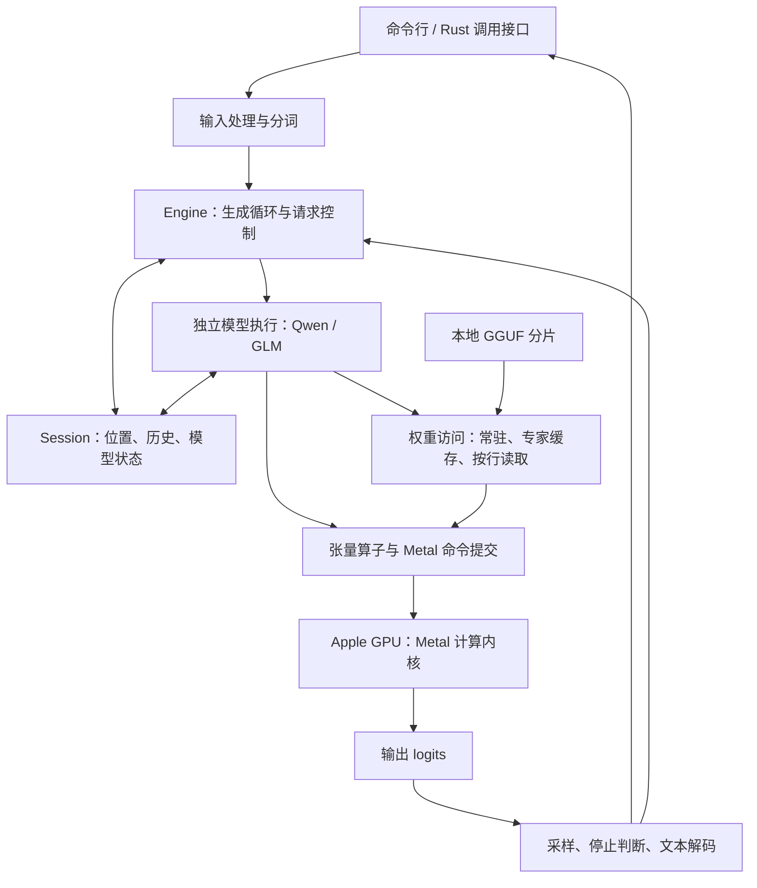
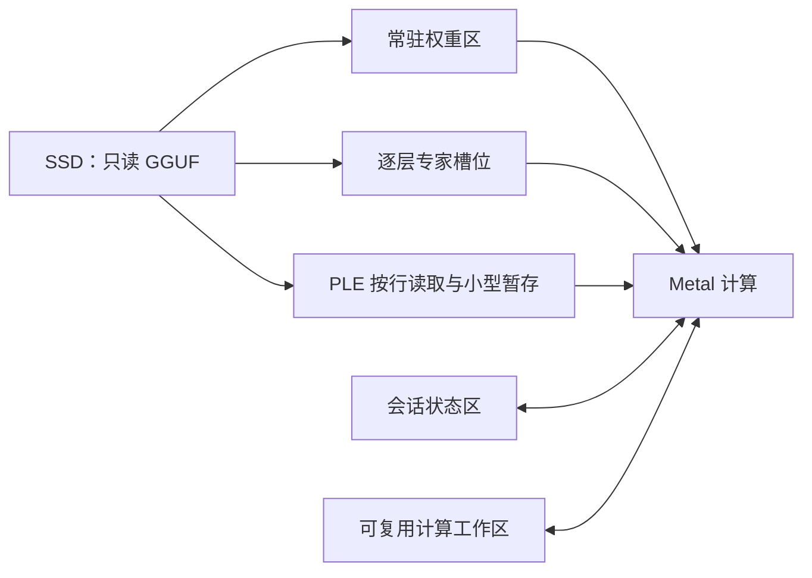

# Rust / Metal MoE 推理引擎架构提案

> **说明**：本文写于 MTP 和前缀缓存实现之前。第 11 节（MTP）及“首版不做”的范围说明反映当时的计划；已实现能力以 [README.md](../README.md) 为准。

当前性能能力补全计划见 [OPTIMIZATION_SPEC.md](history/OPTIMIZATION_SPEC.md)。该 Spec 恢复同机最快推理目标，明确 MTP、矩阵预填充等必做项及验收；本文的首版排期不再作为推迟这些工作的依据。Spec 尚未实施，当前能力仍以验证记录为准。

状态：**用户已授权实施；Qwen 主线、有限内存与分组预填充已验收；GLM 独立主干、完整短请求数值/生成和有限内存验收已通过。**
设计日期：2026-10-11；实现更新：2026-10-12。

本文保留完整设计与取舍。当前实现和实际完成的检查见 [NATIVE_VALIDATION.md](history/NATIVE_VALIDATION.md)，
不能将下文的计划能力全部视为已实现。GLM 5.3 Flash 已选定固定版本 ggml-org Q2_K_S；MTP 尚未实现，补全计划以新 Spec 为准。

## 先看这一页

我们要做的是一个拥有自己模型执行过程的 Rust 推理引擎，面向 Apple Silicon。
第一目标是当前 Qwen3.8-Flash-Next；第二目标是 GLM 5.3 Flash 的文本推理。

**建议的主线：Rust 控制执行与内存，Metal 执行计算；模型分别实现，共享权重读取、
基础算子与专家缓存。** 借鉴 llama.cpp/ggml 的格式和量化实现，保留来源与许可；
生产运行不链接 libllama/libggml，不启动其他引擎。参考引擎只进入评测工具。

| 核心问题 | 建议决定 |
| --- | --- |
| 什么由我们掌握？ | 模型执行、会话状态、内存预算、专家加载、GPU 调度、生成循环。 |
| 复用什么？ | 系统 Metal API、成熟分词组件、GGUF 格式及有许可的量化代码。 |
| 要不要一个通用计算框架？ | 不做。用明确的模型前向过程和有限的张量操作。 |
| 要不要把 Qwen 与 GLM 抽成同一种 Transformer？ | 不强行统一；共享底层，分别实现注意力、路由、超连接和状态。 |
| SSD 是什么角色？ | 内存不足时的权重来源。缓存命中率和真实读取量决定可用速度。 |
| 第一版产品形态？ | 单机、单模型、单个活跃会话，命令行和 Rust 调用接口，文本输入输出。 |
| 怎么算完成？ | 自有路径生成完整文本，分词/逐 token 数值/状态通过对照，再报告端到端性能。 |

审阅时最值得确认的是：**Mac 专用优先、共享底层而分别写模型、先正确生成再优化、
首版不承担并发服务框架**。后面的章节把这些决定展开到可实施边界。

## 1. 范围与事实基础

已确定：用户拥有独立项目；主语言 Rust；当前硬件为 M2 Max / 96 GB 配置；
允许参考 llama.cpp；当前模型为现有 GGUF，后续目标为 GLM 5.3 Flash。
图像、音频、训练、分布式、CUDA、插件市场不在这两阶段的文本推理范围内。

Qwen 首条完整上下文验收线建议设为 8K，再逐级验证更长输入。模型文件声明的最大
上下文不是本引擎已经支持的长度，也不代表当前硬件可以在该长度下满足内存与延迟要求。

以下区分已经核对的事实与本提案的决定，避免把设计当成已经实现的能力。

| 已核对的事实 | 对架构的影响 |
| --- | --- |
| 当前 Qwen GGUF 架构为 `qwen4exp`，48 层、隐藏维度 2560、512 个专家、每 token 选 10 个。 | 按真实架构建立绑定，不能套用普通 Qwen dense 模型。 |
| 当前 Qwen 同时有 Gated DeltaNet、QSA 稀疏注意力、超连接和 PLE。 | 会话状态远多于一个 KV cache；都必须纳入执行、取消和后续 MTP 处理。 |
| 两个 GGUF 文件约 68.026 GB；张量载荷约 68.015 GB。 | 文件大小不能直接当作每 token 活跃内存或 SSD 读取量。 |
| 路由专家权重约 35.455 GB；`per_layer_token_embd.weight` 单独约 28.800 GB；其他张量约 3.760 GB。 | PLE 大表按行取用，与专家缓存分开；不把整张大表常驻到 Metal。 |
| 当前文件实际使用 12 种张量格式，包括自定义 Q2_0。 | 文件名 IQ2_XS 不代表内部统一格式；完整模型需覆盖实际清单。 |
| Apple GPU 与 CPU 共用系统内存，但访问权限和同步仍由 Metal 资源规则约束。 | 不照搬独立显存机器的 CPU 权重副本加 GPU 权重副本设计。 |
| GLM 官方配置为 45 层，其中 34 层线性注意力、11 层稀疏注意力；前 3 层 dense FFN，其余 42 层 MoE，288 选 8。 | GLM 不是替换模型文件即可运行，需要独立模型实现。 |

Qwen 数字来自本地 GGUF 目录解析，模型摘要记录在
[model-sha256.txt](../macos/model-sha256.txt)。GLM 来自
[官方配置](https://huggingface.co/zai-org/GLM-5.3-Flash/raw/main/config.json)。
内存规则见 [Apple 资源存储说明](https://developer.apple.com/documentation/metal/choosing-a-resource-storage-mode-for-apple-gpus)。
GLM 已选定并校验 ggml-org Q2_K_S，约 110.018 GB 张量载荷；16 GiB 短请求实测峰值
15.56 GiB，完整数值、输出和计时见验收记录。GLM 长上下文质量与可控冷读基线尚待验证。

## 2. 为什么采用这条路线

“自己写引擎”不要求重写每个基础组件。判断标准是：谁定义模型执行，谁拥有状态，
谁决定权重何时进入内存、计算何时提交，而不是仓库中能否出现第三方代码。

| 方案 | 能提供什么 | 本项目的决定与代价 |
| --- | --- | --- |
| Rust 调用 llama.cpp | 成熟模型图、算子、分词、服务能力。 | 不作为生产运行路径：模型执行权仍在另一引擎。保留固定版本作 oracle。 |
| Candle | Rust 张量和模型组件，减少基础设施实现。 | 本阶段不作为运行时。直接 Metal 更便于控制专家缓存和提交；代价是我们自己维护算子与数值正确性。 |
| mistral.rs | 已有 Rust 推理项目，可参考模型装载和服务组织。 | 参考实现，不整体嵌入其执行栈；首版也不承接其服务范围。 |
| MLX / mlx-vlm | Mac 张量执行与模型实现，可交叉核对数学和状态。 | 参考模型结构、作为后续独立基线，不包裹 Python/MLX 来冒充 Rust 执行。 |
| Strata | 自有执行流程、CPU/GPU 专家分工、缓存和推测解码经验。 | 借鉴按活跃专家组织数据与计算；不照搬 CUDA、CPU AVX 和独立显存分层。 |
| Anemll 的 MLX 专家流式项目 | 稳定权重槽位、按需读取和常驻/流式分解测量。 | 借鉴槽位管理与实验方法，不把其其他模型成绩算作我们的成绩。 |
| LM Studio | 基于 llama.cpp/MLX 等后端的完整本地产品。 | 可参考产品交互边界；其公开文档证明后端复用路线可行，不证明内部调度细节。 |

参考：[Candle](https://github.com/huggingface/candle)、
[mistral.rs](https://github.com/EricLBuehler/mistral.rs)、
[mlx-vlm](https://github.com/Blaizzy/mlx-vlm)、
[Strata](https://github.com/Niko1221/Strata)、
[Anemll](https://github.com/Anemll/anemll-flash-mlx)、
[LM Studio 文档](https://lmstudio.ai/docs/app)。

采用/改编/自研的边界：

- **采用**：`objc2-metal` / Foundation 系统绑定；成熟 Rust 分词组件；标准文件读取。
- **改编**：ggml 的量化布局、码表和经对照验证的内核思路；保留固定来源及许可证。
- **自研**：下面定义的模型执行、Session、内存预算、专家缓存与执行调度。
- **暂不采用**：自有权重容器、通用图编译器、动态模型插件、多后端 trait 框架。

[metal-rs 已建议新项目使用 objc2-metal](https://github.com/gfx-rs/metal-rs)。
这是一项维护性选择，不是性能优势的证据。性能结论必须来自相同条件的测量。

## 3. 模块边界和所有权

下面是**概念模块**，建议先放在一个 Rust crate 中，包含一个库入口和一个命令行入口。
不按每个模块拆 crate，也不建立组件注册或消息总线。

| 模块 | 负责 | 持有的资源 / 明确不负责的事 |
| --- | --- | --- |
| 输入与分词 | prompt/chat 转 token，特殊 token，输出字节到文本。 | 持有分词器；不管理 GPU 和专家。 |
| Engine | 装载模型、创建 Session、生成循环、请求取消、汇总统计。 | 持有模型、设备与权重资源；不实现某个模型的注意力公式。 |
| 模型实现 | Qwen 或 GLM 的前向顺序、张量绑定、路由规则和状态布局。 | 决定调用哪些算子；不直接操作文件读取线程。 |
| Session | 已消费位置、token 历史、待反馈 token、采样状态和各层状态。 | 每个会话独占；与不可变权重分开，首版仅允许一个活跃 Session。 |
| 权重访问 | GGUF 目录、分片、张量范围、专家与 PLE 行读取。 | 统一提供正确的权重字节；不决定模型选择哪些专家。 |
| 内存与专家缓存 | 常驻区、逐层专家槽位、工作区预算、槽位可复用时机。 | 管理实际分配与在途使用；不能通过少算专家来解决内存不足。 |
| Metal 执行 | 设备能力、buffer、pipeline、命令提交、完成通知和同步。 | `unsafe` 集中在系统绑定与内存访问边界，不泄漏到模型逻辑。 |
| 算子 | 量化 GEMV/GEMM、归一化、注意力、激活、路由、归约等。 | 接收形状、布局和 buffer；不读取 GGUF、不决定生成策略。 |

验证工具在运行时之外，可使用 C++、Python、NumPy 和参考引擎，不进入生产依赖。

**调用方向**：输入 → Engine → 具体模型 → 权重/算子 → Metal。
模型状态由 Session 持有；权重和编译好的 pipeline 不随请求反复重建。
用普通结构体、直接函数调用组织，第二个模型出现时再提取已经重复的部分。

最小调用契约：装载模型、创建会话、消费输入 token、生成后续 token、取消、读取统计。
生成参数只包含实际需要的输出长度、采样参数、种子和停止条件；模型路径、内存预算、
上下文上限属于装载/会话参数，不开放内部 tile、线程和缓存淘汰策略选项。

## 4. 模型与权重装载

装载顺序：读取各分片目录 → 核对模型元数据与必需张量 → 建立模型绑定 →
计算内存需求 → 分配常驻区、状态与工作区 → 创建需要的 Metal pipeline。
任何一步失败，装载返回错误，不留下一个看似可用的半成品 Engine。

权重描述至少保存文件分片、字节范围、维度、行步长、量化格式和模型角色。
它只是已验证的描述与视图，不是第二套计算图。模型绑定后，内层算子不再反复解析
名字、检查文件头或计算文件偏移。

第一阶段只以当前 GGUF 为入口，不设计自有打包格式，不预先把整个模型解量化。
按所需专家或查表行读取原始量化字节；模型文件只读，运行期间不能被其他进程替换或截断。
分片和范围在装载边界检查；实际读取仍必须处理短读和 I/O 错误。

当前完整权重需要覆盖：`F32`、`F16`、`BF16`、`Q8_0`、`Q6_K`、`Q2_0`、
`IQ1_M`、`IQ2_XXS`、`IQ2_S`、`IQ3_S`、`IQ4_NL`、`IQ4_XS`。
其中 Q2_0 的 type ID 42 来自当前 GSQ-RCO 分支约定，不能假定任意未来 GGUF 中
相同数字仍代表同一布局。支持清单跟随目标权重的明确格式，遇到未知格式直接报错。

分词优先复用 [Hugging Face Tokenizers](https://github.com/huggingface/tokenizers) 的成熟核心，
补上当前 GGUF 到该组件的配置适配。选择完成模型对照的稳定版本，再固定依赖；
不因上游最新版本号而直接升级。当前元数据为 `gpt2` + `qwen35` 预分词，必须核对
正则切分、字节映射、merges、特殊 token 和 BOS/EOS 行为，不能仅凭名字判断兼容。

chat template 由输入模块处理，使用目标模型模板中实际需要的语义，核对渲染后的
token 序列；第一阶段不做通用提示词系统、工具执行器或任意模板市场。
多模态输入明确不支持，不把图片占位 token 当作已支持图像。

GLM 当前采用 ggml-org Q2_K_S 两分片（版本与摘要见 PROVENANCE.md）。实际格式为
F32、BF16、Q8_0、Q2_K，预分词为 `gpt2` + `glm4`；已按其真实元数据接入。
不承诺当前读取器可以直接读取官方 FP8 Safetensors。

## 5. 一次请求如何执行

1. 输入模块产生 token；Engine 检查本次输入加输出上限是否在已分配上下文范围内。
2. **Prefill（处理已有输入）**：按受内存预算约束的 token 块执行全部模型层，更新状态，
   最后一个位置的 logits 用于首个输出 token。
3. 采样器按指定策略选 token，判断结束，产生可输出文本；记录随机数状态。
4. **Decode（逐 token 生成）**：把刚选出的 token 反馈给模型，执行全部层，获得下一步 logits。
5. 重复到 EOS、停止条件、长度上限或取消。正常结束返回终止原因与统计。

每层不是独立完成整段对话：它接收同一批 token 的上一层输出，产生下一层输入。
同一层前向中的专家输出必须与该层、该 token 的路由权重配对，不能错用下一层或上一轮的数据。

会话分别记录已被模型消费的位置与已产生的输出，保留尚未反馈给模型的 token。
这一区别用于精确处理结束、缓存位置与后续 MTP，不能用一个模糊的“长度”覆盖所有含义。

## 6. 两个模型分别怎么组织

| 部分 | 当前 Qwen `qwen4exp` | GLM `glm5_next_text` |
| --- | --- | --- |
| 主干 | 48 层；当前配置 36 层 Gated DeltaNet、12 层 QSA。 | 45 层；34 层线性注意力、11 层稀疏注意力。 |
| 路由 | Softmax 后取 top-10 并归一化，512 专家；共享专家另有门控。 | Sigmoid 分数与选择偏置，288 选 8；当前路由缩放 2.5，不能直接复用 Qwen 的公式。 |
| FFN | 各层 MoE，含共享专家。 | 前 3 层 dense，其余 MoE；有受限 SwiGLU 等差异。 |
| 超连接 | 4 路、低秩的 gated residual / hyper-connection。 | 4 路 mHC，含 Sinkhorn 等计算；不是相同算子换参数。 |
| 查表 | PLE n-gram 查表、卷积及历史状态。 | 不预设存在 Qwen 的 PLE。 |
| 稀疏注意力 | QSA，含索引键、位置和压缩块摘要。 | NoPE/MLA 与 DSA、池化索引及索引复用关系。 |
| 状态 | 循环矩阵、短卷积历史、QSA KV/索引、PLE 历史。 | KDA 循环/卷积状态、MLA/DSA 缓存、池化与跨层索引相关状态。 |

Qwen 前向按真实配置执行：token embedding → 扩展到超连接流 → 对应层的 PLE 分支 →
注意力超连接混合 → Gated DeltaNet 或 QSA → 注入残差流 → FFN 超连接混合 →
路由与共享专家 → 注入残差流 → 最终超连接汇合与输出头。
具体归一化位置及参数绑定以参考模型公式为准，不把这张顺序图当成省略算子的许可。

GLM 则单独组织 embedding、mHC、线性/稀疏注意力、dense/MoE FFN、最终归一化和输出头。
共享量化矩阵运算、内存和 I/O；不共享错误的注意力状态或路由语义。

参考了固定版本 mlx-vlm 的
[Qwen 实现](https://github.com/Blaizzy/mlx-vlm/blob/4f4634bb813c0298cb1467bed2e957526c71d0b4/mlx_vlm/models/qwen4_exp/language.py)、
[GLM 实现](https://github.com/Blaizzy/mlx-vlm/blob/4f4634bb813c0298cb1467bed2e957526c71d0b4/mlx_vlm/models/glm5_next/language.py)，
以及当前 llama.cpp 分支的
[Qwen 模型图](https://github.com/memoriaru/llama.cpp/blob/555d1ec9daa4564cb06adb39c469acfdcd1d1e93/src/models/qwen4exp.cpp)。
第三方实现用来交叉核对；有冲突时核对官方配置、权重与逐层输出，不以代码多数票决定。

## 7. 内存架构：按用途分配，共享一个物理预算

这里的框是资源用途，不是额外的独立 RAM/VRAM 层。Apple Silicon 的 shared buffer
允许 CPU 和 GPU 访问同一份系统内存；**共享地址不消除同步要求**。
GPU 正在读取的专家槽位不能被读取线程覆盖。[Apple 同步说明](https://developer.apple.com/documentation/metal/mtlstoragemode/shared)

预算关系：

`引擎预算 ≥ 常驻权重 + 专家槽位 + 会话状态 + 计算工作区 + 在途读取/输出暂存`

- 常驻权重：频繁使用的稠密矩阵、路由、共享专家、embedding/输出头等；不重复保留完整 CPU/GPU 副本。
- 专家槽位：按量化字节占用计费，不能只报告“64 个槽位”而不说明每层数量与字节数。
- Session 状态：按上下文上限和模型真实布局预估 KV、索引、循环状态和历史；不是全部线性随上下文增长。
- 工作区：prefill token 块、激活、专家部分结果、attention 临时量，按最大同时存活量复用。
- PLE：28.8 GB 大表按所需行读取，使用有界暂存；先利用系统文件缓存，不额外设计第二套大表缓存。

系统文件缓存、其他应用和系统开销不受引擎分配器完全控制；给系统留余量。
RSS、physical footprint、Metal 分配、系统 wired 与 swap 是不同观测量，分别报告，
不简单相加，也不把低 RSS 宣传成全部物理内存占用。

首版在装载/创建会话时固定预算。预算容不下必需工作集就明确失败；不静默缩小专家数、
降低精度或截断上下文。`maxBufferLength` 等设备限制决定分配分段，不能假设单个
几十 GB Metal buffer 始终可创建。

模型状态与常驻权重优先得到预算，剩余部分决定专家槽位。当前 Qwen 可先建立
**路由专家常驻基线**，同时让 PLE 保持按行读取；这一基线不应标成“所有文件均已常驻”。

## 8. 专家缓存与 SSD 调度

### 8.1 两种内存占用，同一套模型数学

常驻条件下，专家字节长期位于可计算的 buffer 中；内存受限时，由文件补入槽位。
两条路径使用相同路由、相同权重与相同算子语义，差异只有权重可用时机。

缓存以“某层某专家的一组 gate/up/down 矩阵”为身份，保留各矩阵真实量化格式和偏移。
**初版采用每层固定槽位、层内 LRU，容量由总字节预算计算。** 不先做动态跨层分配、
热度预测或自适应策略。槽位覆盖一个执行分组；更多候选专家可以分组处理。

槽位只有在全部读取完成后才可被计算使用。提交 GPU 后，直到消费它的命令完成才能淘汰；
取消也不改变这条所有权规则。短读、损坏范围或 I/O 错误不能产生“可用”的部分专家。

### 8.2 Decode

1. GPU 完成该层注意力与路由。常驻路径直接在 GPU 上消费选中 ID，不回传完整路由 logits。
2. 流式路径在明确完成点读取很小的专家 ID 列表；路由权重和大激活继续留在 GPU。
3. 查询槽位；命中专家可计算，未命中专家由有界的读取线程使用位置读取补入 shared buffer。
4. 读取缺失专家时，尽可能计算已命中的专家和独立的共享专家分支。
5. 所需专家结果齐全后，按该 token 的路由权重合并，再进入下一层。

第一版重型矩阵计算交给 GPU，CPU 负责 I/O 与控制。Apple CPU/GPU 会争用同一内存带宽，
不能从 Strata 的独立显存环境直接推断“CPU 帮算未命中专家”一定更快。

### 8.3 Prefill

先处理当前 token 块的路由，再把 token 按选中专家分组：同一个专家加载一次，为组内
多个 token 做矩阵计算，然后把结果写回各 token 的贡献位置。槽位数不需要等于
`token 块长度 × top-k`。

读取下一组已经确定的专家，与当前组计算重叠。临时贡献和最终归约保留正确的 token、
专家及层对应关系；不依赖无序浮点原子加法来掩盖排列差异。贡献缓存也计入工作区预算。

**不承诺默认预测下一层专家。** 下一层的正确路由依赖前面计算；首版只重叠已经知道
需要读取的数据。预测预取只有在后续追踪证明有效且不抢占必需读取时才值得加入。

### 8.4 性能可行性先算账

从当前 GGUF 的逐专家大小推得，48 层每层 top-10 的专家字节总和为
**692,480,000 bytes/token**，不含稠密权重、PLE、额外预取和 MTP。
这是活跃专家量；只有未命中的部分需要从文件补入。

`文件补入量 ≈ 各层被选且未命中专家的实际字节之和`

`完全冷读时的 I/O 时间下界 ≈ 实际物理读取字节 / 该访问模式下有效 SSD 吞吐`

假设全未命中、有效 SSD 吞吐为 **3 GB/s**，仅这些专家的读取就约 **231 ms/token**，
对应理论上限约 **4.3 token/s**，尚未计入计算和读取调度。3 GB/s 是示例假设，
不是本机测量；文件缓存命中、SSD 随机访问和预取会改变真实结果。

必须区分引擎槽位命中率、从文件读取的字节数和真实 SSD 物理读取量。
OS 文件缓存命中的 `pread` 不能标成冷 SSD 成绩，也不能只看命中率而忽略等待时间。

GLM 官方称总参数 320B、激活参数 18B。粗按总参数每个 4 bit 估算，仅权重约
160 GB，已经大于当前 96 GB 配置；这是容量估算，真实量化文件还需核对元数据和混合精度。
因此 GLM 的权重选择、缓存收益及可接受延迟是实质性风险，不能只承诺“支持架构就会快”。
[GLM 官方模型卡](https://huggingface.co/zai-org/GLM-5.3-Flash/raw/main/README.md)

## 9. Metal 计算与数值策略

采用一条计算队列和有界 I/O 工作队列；先不引入异步运行时或复杂多队列调度框架。
pipeline 按实际算子及精度在装载时创建并复用，不逐 token 编译 shader。

模型过程直接组织必要的 kernel 序列。decode 使用量化 GEMV / 小批量运算，prefill
使用 GEMM 和专家分组路径；不把逐 token 的简单 kernel 原样循环当作最终 prefill 实现。

共享的基础操作包括量化读取/矩阵计算、归一化、激活、归约、gather/scatter 和 top-k。
Gated DeltaNet、QSA、KDA、DSA、PLE 和两种超连接保留各自明确的模型语义。
先实现可核对的组合，再根据计时选择融合，不一次同时改公式、精度和调度。

正确性基线保留权重量化原样，激活和状态先使用明确固定的精度，优先建立 F32 基线；
归一化、softmax、路由、归约及循环状态的精度不能随 kernel 隐式变化。
降低激活/KV 精度、输入再量化与更快的归约顺序各自单独验证，初版不开放精度模式组合。

每个 kernel 的契约包括输入形状/步长、量化块布局、输出形状、精度、可写区域和同步依赖。
视图与切片必须携带真实布局；量化行不能按普通 F32 字节步长处理。
生产算子不进行全量反量化缓存，只有参考测试或受控小范围工作区可以展开权重。

提交按层或有界计算分组组织，在途命令数量有上限，避免为每个小算子单独提交并等待。
常驻路径不因 CPU 取路由分数而打断每层；流式路径只在 ID 可见、读取完成等真实依赖点同步。
共享内存通过命令完成/事件建立先后关系，不把普通指针读写或忙等当成跨处理器同步。

## 10. 状态、停止与失败

Session 状态按具体模型定义。Qwen 至少包括循环状态矩阵、短卷积历史、QSA KV、
索引键与压缩尾块、PLE n-gram/卷积历史，以及必要的位置数据；GLM 保留其 KDA、
MLA/DSA、池化索引和跨层索引语义，不转换成一个假通用 KV 数组。

当前 Qwen 的生成 EOS 为 248046，而 PLE 的重置标记元数据为 248044。
两者角色不同，按各自模型元数据处理，不使用全局 EOS 判断替代 PLE 边界。

普通首版不做跨请求前缀缓存、状态落盘或断点恢复。会话取消后丢弃该 Session，
保持不可变模型和未损坏的权重缓存可复用；调用方可用已保留 token 重新建立会话。
这样不必为了取消给每个正常 token 复制所有循环状态。

取消在有界提交边界生效，不再排新工作；已提交 GPU 命令不能假设立即撤回。
在途文件读取和 GPU 使用结束后才能回收或改写其 buffer。取消延迟需要实测，
不得仅因设置了一个标志就宣称请求已完全退出。

I/O、分配、GPU 执行和数值异常通过调用边界返回失败；日志不是成功结果。
部分输出后发生错误，要把已输出内容与失败终止区分。发生设备错误时，当前 Session
失效；若设备资源不可继续使用则重建 Engine，不在损坏状态上继续生成。

验证集中在文件装载与外部输入边界；算子内部保留必要形状与内存安全约束。
不建立额外的通用规则引擎，也不静默更换格式、模型或精度来“恢复成功”。

## 11. MTP 的位置：后续优化，不阻塞普通生成

先把普通生成的执行与状态语义确定。MTP 由模型提供草稿路径，Engine 控制提议、
目标验证、接受前缀和输出；草稿 token 在目标确认前不能输出给用户。

MTP 的状态恢复必须包括：KV 的逻辑长度和被改写尾部、循环矩阵、卷积历史、
稀疏索引/压缩尾块、PLE 历史、token 位置和采样状态。不能只截短 KV 长度。

最初可采用“提议前保存必要状态；部分接受时恢复并重放接受前缀”的正确性方案。
它可能较慢，但容易与普通生成核对；只有测量表明复制/重放是瓶颈才优化状态增量。
不在当前设计中提前实现持久化快照、分支树或通用事务系统。

先验收 greedy 场景。以后支持随机采样时，必须实现与目标分布一致的接受/拒绝算法，
不是“目标模型也给了高分就接受”。只有完整请求时间改善且质量检查通过才启用 MTP。

## 12. 怎么验证这真的是一个正确、可用的引擎

| 验收层级 | 检查内容 | 能证明什么 |
| --- | --- | --- |
| 产物与分词 | 文件范围、量化块、中文/英文/代码/特殊 token 与模板的 token 序列。 | 输入和权重解释正确，尚不证明生成正确。 |
| 单算子 | 与独立解量化/高精度参考比较，覆盖当前实际格式和形状。 | 指定数值路径正确，不能替代整层测试。 |
| 整层 | Attention、PLE、超连接、FFN 和状态更新，检查跨调用后的中间输出。 | 排序与状态绑定正确。 |
| 整模型 | Teacher-forced 逐 token logits、分段 prefill 与逐 token 输入、生成文本。 | 对完整模型建立数值与行为证据。 |
| 系统行为 | 上下文边界、短读、OOM、取消、再次请求、重复使用缓存。 | 资源与错误路径不产生伪成功或状态串扰。 |
| 优化候选 | 常驻/流式、不同 prefill 块大小、普通/MTP 的配对对照。 | 确定收益和适用范围。 |

浮点结果不笼统要求所有 kernel 位级相同。按算子精度记录误差，整模型比较 logits、
概率差、top token 及分歧发生位置；greedy 分歧必须解释，不能只看文本“像样”。
模型原有错误与引擎引入的退化分开统计。随机采样有自己的分布与可复现性检查。

首个正确性参照为现有固定版本 llama.cpp；独立量化/公式 oracle 用 NumPy 等工具。
mlx-vlm/MLX 用作第二实现的交叉核对和性能基线。参考依赖保留版本、权重标识和条件，
不把本次 FFN 原型的三个输入对照升级成“整个 Qwen 已正确”。

必须报告：装载时间、首 token 时间、prefill 时间/吞吐、decode 延迟分布、完整请求时间、
峰值内存、专家缓存字节与命中、读取等待、文件读取量和可取得的物理 I/O 指标。
MTP 额外报告接受率、状态复制/重放成本与完整请求收益。

测试使用相同权重、分词、精度、输入/输出长度、上下文和并发，分别标注专家常驻、
暖文件缓存和可证明的冷读条件。成对交替运行，保留慢样本；详细逐算子同步计时与
正常端到端计时分开，避免 profiling 本身改变调度后仍被当成真实吞吐。

## 13. 实施顺序与每阶段出口

实施已经获得用户授权。下表仍保留各阶段出口；是否通过以实际检查记录为准。

| 阶段 | 交付 | 进入下一阶段的条件 |
| --- | --- | --- |
| A：架构评审 | 本文、关键取舍、模型和硬件边界。 | 用户确认或修订。 |
| B：Qwen 正确性主线 | 完整格式/分词、模型算子、状态、专家常驻的完整文本生成；PLE 按行取用。 | 逐层、逐 token 与完整请求正确性通过。 |
| C：Qwen 有限内存 | 预算、逐层专家槽位、读取/计算重叠、分组 prefill。 | 与常驻路径数值对齐，内存符合预算，真实 I/O 与延迟可解释。 |
| D：Qwen 性能 | 有证据的 kernel 融合、批处理和可选 MTP。 | 完整请求改善且质量不退化，不以局部吞吐代替结论。 |
| E：GLM 5.3 Flash | 确定量化产物，补齐模型执行、状态和新算子，复用已验证底层。 | 同样通过独立正确性与容量/速度评估。 |

B 阶段应沿完整生成链路推进，而不是把某个 FFN kernel 优化到极致后才连接注意力。
不在 GLM 实现前承诺相同速度或相同缓存配置适用。硬件容量、量化产物与数值对齐
是 E 阶段真正的前置条件。MTP 是可选优化，不是启动 GLM 适配的前置条件；
GLM 的具体排期可在 Qwen 正确性与内存基础稳定后决定。

## 14. 需要审阅的决定与尚待测量的内容

建议批准的架构决定：一个 crate、直接 Metal、自有模型前向与 Session、模型分别实现、
GGUF 优先、同一数学路径下的常驻与按需读取、首版单活跃会话、普通生成先于 MTP。

当前不能用设计替代实测的项目：Qwen 在不同上下文下的内存余量；SSD 访问模式下的
有效带宽；逐层缓存命中；合适的 prefill 块大小和提交粒度；Rust 引擎相对参考实现的
实际速度；GLM 量化文件及本机可用延迟。为这些问题保留实验位置，不为它们提前制造配置系统。

正式项目名和远程仓库可见性不影响以上核心架构，可单独决定。已有原型可以复用
经验证的部分，但它的 CLI、文件划分、CPU 路由和同步方式都不是已经批准的长期设计。

当前 Rust/Metal 实现已按这份设计推进。没有提交或发布；实现范围与未完成验收见 [NATIVE_VALIDATION.md](history/NATIVE_VALIDATION.md)。
